<p align="center">
  <picture>
    <source media="(max-width: 600px)" srcset="./assets/header-mobile.svg" />
    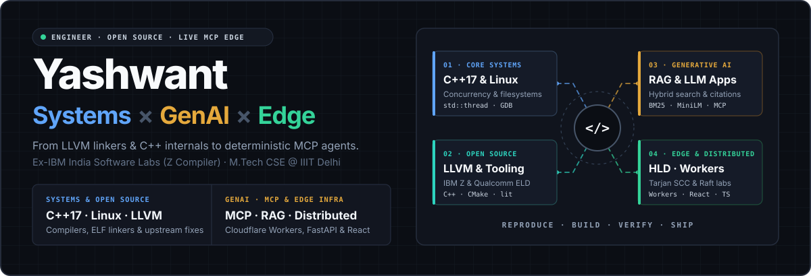
  </picture>
</p>

<p align="center">
  <strong>Software engineer · Systems × GenAI · M.Tech, IIIT Delhi</strong>
</p>

<p align="center">
  <a href="https://yashwant-rana.vercel.app/"><strong>Explore my portfolio &amp; project case studies ↗</strong></a> &nbsp; / &nbsp;
  <a href="#selected-work">Projects</a> &nbsp; / &nbsp;
  <a href="#interactive-sandbox--live-mcp">Interactive sandbox</a> &nbsp; / &nbsp;
  <a href="#live-upstream-oss--edge-telemetry">Live telemetry</a> &nbsp; / &nbsp;
  <a href="https://www.linkedin.com/in/yash-rana-3a7252265/">LinkedIn</a>
</p>

I build across **systems engineering and generative AI**—from C++ linker fixes and Linux concurrency to retrieval-backed assistants and LLM-powered developer tools.

I care about what happens around the core algorithm: **reproducible failures, useful evidence, reliable APIs, and a product people can inspect and use.**

At **IBM India Software Labs**, I worked on the **IBM Z C/C++ compiler**, resolved **8+ production defects**, and implemented an **MCP service for compiler-diagnostic retrieval**. Software Engineer: July 2025–September 2026; intern: January–July 2025.

My [portfolio](https://yashwant-rana.vercel.app/#work) brings together **six featured projects**, linker contributions, implementation details, and code links. Search by technology or explore systems, AI/ML, applications, and research.

## Contribution activity

<p align="center">
  <a href="https://github.com/yashwant938?tab=overview">
    <picture>
      <source media="(max-width: 600px)" srcset="./assets/contribution-streaks-mobile.svg" />
      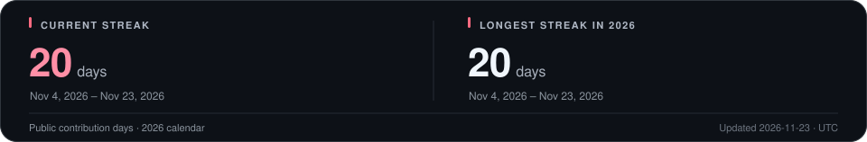
    </picture>
  </a>
</p>

<p align="center">
  <a href="https://github.com/yashwant938?tab=overview">
    
  </a>
</p>

## Selected work

<table>
<tr>
<td width="50%" valign="top">
<a href="https://yashwant-rana.vercel.app/#eld"><picture><source media="(prefers-reduced-motion: reduce)" srcset="./assets/projects/static/eld.svg" /></picture></a>
<sub><strong>SYSTEMS · C++ · OPEN SOURCE</strong></sub>
<h3><a href="https://github.com/qualcomm/eld">Qualcomm ELD Contributions</a></h3>
<p><strong>Five merged fixes</strong> in an ELF linker built on LLVM:</p>
<ul>
<li><a href="https://github.com/qualcomm/eld/pull/2065"><strong>#2065</strong></a> — Fixed a PHDRS/FILEHDR layout crash.</li>
<li><a href="https://github.com/qualcomm/eld/pull/2011"><strong>#2011</strong></a> — Added GNU-compatible handling of numeric <code>-O</code> options.</li>
<li><a href="https://github.com/qualcomm/eld/pull/2129"><strong>#2129</strong></a> — Preserved native ARM/AArch64 LTO object emission with <code>--save-temps</code>.</li>
<li><a href="https://github.com/qualcomm/eld/pull/2207"><strong>#2207</strong></a> — Added source line numbers to <code>PROVIDE</code> / <code>PROVIDE_HIDDEN</code> redeclaration warnings.</li>
<li><a href="https://github.com/qualcomm/eld/pull/2336"><strong>#2336</strong></a> — Included map-file assignments before <code>SECTIONS</code> in YAML output.</li>
</ul>
<p>Focused regression testing across six architecture configurations. Each PR records its verification scope; the full ELD suite was not run.</p>
<p><code>C++</code> <code>LLVM</code> <code>Linux</code> <code>lit / FileCheck</code></p>
<a href="https://github.com/qualcomm/eld/pulls?q=is%3Apr+author%3Ayashwant938">Explore the contributions →</a>
</td>
<td width="50%" valign="top">
<a href="https://arch-guard-mcp.yashwant938.workers.dev"><picture><source media="(prefers-reduced-motion: reduce)" srcset="./assets/projects/static/arch-guard-mcp.svg" /></picture></a>
<sub><strong>GENAI × SYSTEMS · MCP SERVER · STATIC ANALYSIS</strong></sub>
<h3><a href="https://github.com/yashwant938/arch-guard-mc">ArchGuard MCP</a></h3>
<p>Zero-dependency <strong>Model Context Protocol (<code>2025-03-26</code>) server</strong> published on the <strong>Official MCP Registry</strong> (<code>io.github.yashwant938/arch-guard-mc@1.0.0</code>), with a live zero-auth Streamable HTTP endpoint on Cloudflare Workers and local <code>stdio</code> repo auditing.</p>
<ul>
<li>Runs <strong>Tarjan's O(V+E) SCC</strong> cycle detection, Robert C. Martin <code>Ca / Ce / I</code> coupling, 12 reliability/SOLID rules, and a <strong>3-phase Expand-Contract SQL DDL guardian</strong> (<code>MIG-001</code>–<code>MIG-008</code>).</li>
<li>Exposes <strong>7 deterministic tools</strong> (6 remote HTTP + 1 local repo scanner), <strong>4 resources</strong>, and <strong>3 prompts</strong>, including Dynamo/Raft quorum, Jeff Dean tail-latency amplification, and FNV-1a consistent-hashing simulators.</li>
</ul>
<p>Zero runtime dependencies; verified by <strong>8 passing tests</strong> across engine unit checks, self-audit dogfooding, local <code>stdio</code> MCP, and Streamable HTTP Worker flows.</p>
<p><code>JavaScript</code> <code>MCP 2025-03-26</code> <code>Cloudflare Workers</code> <code>Tarjan SCC</code> <code>SQL DDL</code></p>
<a href="https://arch-guard-mcp.yashwant938.workers.dev">Live explorer ↗</a> · <a href="https://registry.modelcontextprotocol.io/v0.1/servers/io.github.yashwant938%2Farch-guard-mc/versions/latest">Official MCP Registry ↗</a> · <a href="https://github.com/yashwant938/arch-guard-mc">Source &amp; setup →</a>
</td>
</tr>
<tr>
<td width="50%" valign="top">
<a href="https://yashwant-rana.vercel.app/#legal-lens"><picture><source media="(prefers-reduced-motion: reduce)" srcset="./assets/projects/static/legal-lens.svg" /></picture></a>
<sub><strong>GENAI · RAG · RETRIEVAL &amp; ANSWER EVALUATION</strong></sub>
<h3><a href="https://github.com/ZainiiiBoyx278/legal-lens">Legal Lens 2.0</a></h3>
<p>Contributed token-aware <strong>BM25 + MiniLM hybrid retrieval</strong> over a <strong>1,871-page historical IPC corpus</strong>, with reciprocal rank fusion, page-linked evidence, and document-excerpt fallback.</p>
<ul>
<li>Reduced chunks exceeding the encoder limit from <strong>22.0% to 0%</strong>; verified fallback, cache invalidation, citation checks, and related behavior within <strong>46 passing offline backend tests</strong>.</li>
<li>Evaluated <strong>80 held-out positive queries, 20 negative probes, and 60 local generation cases</strong>, with agent-authored labels, claim-level citation-support review, and abstention analysis.</li>
</ul>
<p><strong>Passage Hit@5:</strong> BM25 86.25% · hybrid 80.00%. These measure retrieval, not answer accuracy; the local answer audit exposed unsupported claims and incomplete answers.</p>
<p><code>Python</code> <code>FastAPI</code> <code>BM25</code> <code>MiniLM</code> <code>RAG</code></p>
<a href="https://github.com/ZainiiiBoyx278/legal-lens/blob/main/backend/evaluation/retrieval_v2/README.md">Benchmark &amp; evidence ↗</a> · <a href="https://github.com/ZainiiiBoyx278/legal-lens/pulls?q=is%3Apr+author%3Ayashwant938+is%3Amerged">My project PRs →</a>
</td>
<td width="50%" valign="top">
<a href="https://system-design-guide.yashwant938.workers.dev"><picture><source media="(prefers-reduced-motion: reduce)" srcset="./assets/projects/static/system-design-atlas.svg" /></picture></a>
<sub><strong>DISTRIBUTED SYSTEMS · HLD &amp; LLD · INTERACTIVE LABS</strong></sub>
<h3><a href="https://system-design-guide.yashwant938.workers.dev">System Design Mastery Atlas</a></h3>
<p>Interactive visual engineering platform on Cloudflare Edge covering <strong>14 modules (100 animated 2.5D isometric lessons)</strong> across HLD fundamentals, Big Tech <em>In-The-Wild</em> production deep dives, and LLD machine coding.</p>
<ul>
<li>Ships <strong>6 live simulators</strong>: Consistent Hashing ring, Rate Limiter Arena, LRU &amp; Cache Stampede mutex, Dynamo Quorum &amp; 5-node Raft Consensus, Napkin Math Estimator, and LLD concurrency / Elevator LOOK labs.</li>
<li>Includes Big Tech breakdowns (Shopify, Slack, Figma, Meta, Spotify, Stripe), all <strong>23 GoF patterns</strong>, SOLID comparator, 15 multi-language LLD designs, and a <strong>100-question mock exam</strong>.</li>
</ul>
<p>Self-contained client-side platform verified by <strong>3 passing content-integrity suites</strong> (lesson scenes, GoF/SOLID completeness, and quiz/rubric validation).</p>
<p><code>React 19</code> <code>Vite</code> <code>Tailwind CSS</code> <code>Cloudflare Workers</code> <code>2.5D SVG</code></p>
<a href="https://system-design-guide.yashwant938.workers.dev">Live platform ↗</a> · <a href="https://github.com/yashwant938/System-Design-Compelte-Guide">Source &amp; curriculum →</a>
</td>
</tr>
<tr>
<td width="50%" valign="top">
<p><a href="https://yashwant-rana.vercel.app/#cpp-systems">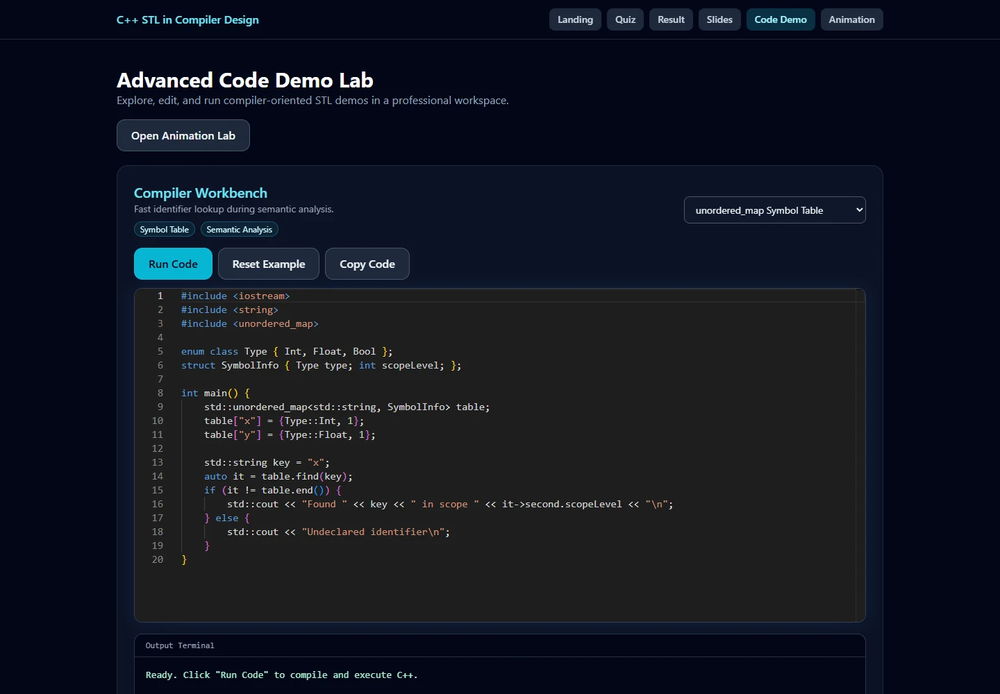</a></p>
<sub><strong>C++ / SYSTEMS / INTERACTIVE LEARNING</strong></sub>
<h3><a href="https://yashwant-rana.vercel.app/#cpp-systems">C++ Concepts &amp; Systems Lab</a></h3>
<p>Interactive C++ STL, OOP &amp; memory-internals lessons, a CppNuts C++20 multithreading &amp; concurrency studio, and a C++17 filesystem lab exploring containers, vtables, alignment, move semantics, and synchronization.</p>
<ul><li>Step-through STL, OOP memory &amp; CppNuts multithreading simulations (greedy alignment, vtable/vptr, lvalue/rvalue, diamond virtual base, 5 thread creation ways, mutex/deadlock, condition_variable, thread pool), an editable C++20 compiler workspace, quizzes, and an optional Gemini tutor.</li><li>cd / ls / cp / mv / rm; sequential and threaded variants with synchronized output.</li></ul>
<p><code>C++20</code> <code>C++17</code> <code>std::filesystem</code> <code>std::thread</code> <code>Linux</code> <code>React</code> <code>Monaco</code></p>
<p>Complementary labs: browser teaching simulations (STL, OOP memory &amp; CppNuts multithreading) and an educational filesystem interpreter. Includes timing scripts; no measured speedup claimed.</p>
<a href="https://yashwant-rana.vercel.app/labs/cpp-oop/">OOP &amp; memory lab ↗</a> · <a href="https://yashwant-rana.vercel.app/labs/cpp-threading/">Threading lab ↗</a> · <a href="https://yashwant-rana.vercel.app/labs/cpp-stl/">STL studio ↗</a> · <a href="https://github.com/yashwant938/CompilerCppTopics">STL source ↗</a> · <a href="https://github.com/yashwant938/portfolio-/tree/main/projects/cpp-oop">OOP &amp; threading source ↗</a> · <a href="https://github.com/yashwant938/OOPD-Project">Systems source ↗</a> · <a href="https://yashwant-rana.vercel.app/#cpp-systems">Case study →</a>
</td>
<td width="50%" valign="top">
<a href="https://yashwant-rana.vercel.app/#gpt2-summarization"><picture><source media="(prefers-reduced-motion: reduce)" srcset="./assets/projects/static/gpt2-summarization.svg" /></picture></a>
<sub><strong>NLP · FINE-TUNING · MODEL EVALUATION</strong></sub>
<h3><a href="https://github.com/yashwant938/CSE508_Winter2024_A4_MT23107">GPT-2 &amp; T5 Review Summarization</a></h3>
<p>Fine-tuned and compared GPT-2 and T5-small on <strong>6,000 Amazon Fine Food Reviews</strong>, using 512 validation reviews for model selection and a <strong>fresh 512-review test set</strong>.</p>
<ul>
<li>Summary-only loss, duplicate-aware splits, reloadable checkpoints, and <strong>22 passing offline tests</strong>.</li>
<li>Paired ROUGE analysis and a source-grounded <strong>24-review product-detail audit</strong>, with agent-authored labels.</li>
</ul>
<p><strong>Test ROUGE-L F1:</strong> GPT-2 0.1275 · T5 0.1255 · lead-16 0.0974. No clear GPT-2/T5 advantage; preserving specific product details remains a limitation.</p>
<p><code>Python</code> <code>PyTorch</code> <code>Hugging Face</code> <code>GPT-2</code> <code>T5</code></p>
<a href="https://github.com/yashwant938/CSE508_Winter2024_A4_MT23107/blob/main/results/t5-comparison/REPORT.md">Benchmark &amp; evidence ↗</a> · <a href="https://github.com/yashwant938/CSE508_Winter2024_A4_MT23107/blob/main/COMPARISON.md">Reproduce the experiment →</a>
</td>
</tr>
</table>

<details>
<summary><strong>Earlier projects &amp; explorations</strong></summary>

<p>More prototypes and learning projects, preserved in the <a href="https://yashwant-rana.vercel.app/archive.html#work">portfolio archive</a>. Illustrations below are concept artwork unless noted as a live capture.</p>

<table>
<tr>
<td width="50%" valign="top">
<p><a href="https://yashwant-rana.vercel.app/labs/signal/">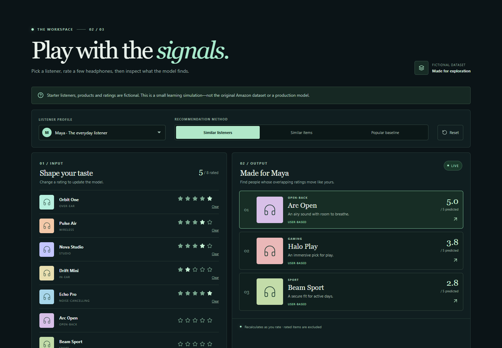</a></p>
<sub><strong>MACHINE LEARNING / COLLABORATIVE FILTERING</strong></sub>
<h3><a href="https://yashwant-rana.vercel.app/labs/signal/">Signal · Recommendation Lab</a></h3>
<p>An interactive lab comparing user-based and item-based collaborative filtering with a regularized popularity baseline.</p>
<ul><li>Adjust listener ratings, compare predictions, and inspect the neighbor evidence behind each suggestion.</li><li>Explore leave-one-rating-out MAE, direct coverage, and cold-start fallbacks.</li></ul>
<p><code>React</code> <code>TypeScript</code> <code>Vite</code> <code>Recharts</code></p>
<p>Learning demo with fictional ratings and products; ratings stay in browser local storage.</p>
<a href="https://yashwant-rana.vercel.app/labs/signal/">Live demo ↗</a> · <a href="https://github.com/yashwant938/portfolio-/tree/main/projects/signal">Source &amp; methods ↗</a> · <a href="https://yashwant-rana.vercel.app/#signal-lab">Case study →</a>
</td>
<td width="50%" valign="top">
<a href="https://yashwant-rana.vercel.app/#real-estate"><picture><source media="(prefers-reduced-motion: reduce)" srcset="./assets/projects/static/real-estate.svg" /></picture></a>
<sub><strong>BACKEND / PROPERTY MARKETPLACE</strong></sub>
<h3><a href="https://yashwant-rana.vercel.app/#real-estate">Real Estate Aggregator</a></h3>
<p>A PHP/Slim property marketplace connecting searchable listings, account workflows, MySQL persistence, Razorpay integration, and generated PDF contracts.</p>
<p><strong>Full-stack prototype</strong></p>
<p><code>PHP</code> <code>Slim</code> <code>MySQL</code> <code>JavaScript</code> <code>Razorpay</code> <code>TCPDF</code></p>
<a href="https://github.com/yashwant938/E-Commerce">Source &amp; architecture ↗</a>
</td>
</tr>
<tr>
<td width="50%" valign="top">
<a href="https://yashwant-rana.vercel.app/archive.html#llvm-bugsquad"><picture><source media="(prefers-reduced-motion: reduce)" srcset="./assets/projects/static/llvm-bugsquad.svg" /></picture></a>
<sub><strong>GENAI × SYSTEMS · DEVELOPER TOOLS</strong></sub>
<h3><a href="https://github.com/yashwant938/LLVMBugSquad">LLVM BugSquad</a></h3>
<p>Compiler investigation workspace with model-assisted routing, isolated LLVM recipes, SQLite history, resumable events, and hashed evidence exports.</p>
<p><strong>Status:</strong> synthetic replay demo. Live model/worker integration validation pending.</p>
<p><code>Python</code> <code>FastAPI</code> <code>Docker</code> <code>LLM APIs</code></p>
<a href="https://yashwant-rana.vercel.app/archive.html#llvm-bugsquad">Case study →</a> · <a href="https://github.com/yashwant938/LLVMBugSquad#readme">Source &amp; setup</a>
</td>
<td width="50%" valign="top">
<a href="https://yashwant-rana.vercel.app/archive.html#newsscript"><picture><source media="(prefers-reduced-motion: reduce)" srcset="./assets/projects/static/newsscript.svg" /></picture></a>
<sub><strong>GENAI · FULL-STACK APPLICATIONS</strong></sub>
<h3><a href="https://github.com/yashwant938/NewsScript">NewsScript</a></h3>
<p>RSS ingestion, deduplication, and heuristic ranking feed a script-drafting workspace with optional Gemini/OpenAI generation, saved articles, and text/PDF exports.</p>
<p><strong>Status:</strong> local prototype with a template fallback. Live-provider validation and deployment hardening are pending.</p>
<p><code>TypeScript</code> <code>Next.js</code> <code>Prisma</code> <code>LLM APIs</code></p>
<a href="https://yashwant-rana.vercel.app/archive.html#newsscript">Case study →</a> · <a href="https://github.com/yashwant938/NewsScript#readme">Source &amp; setup</a>
</td>
</tr>
<tr>
<td width="50%" valign="top">
<a href="https://yashwant-rana.vercel.app/archive.html#moodpet"><picture><source media="(prefers-reduced-motion: reduce)" srcset="./assets/projects/static/moodpet.svg" /></picture></a>
<sub><strong>DESKTOP / PRODUCTIVITY</strong></sub>
<h3><a href="https://yashwant-rana.vercel.app/archive.html#moodpet">MoodPet</a></h3>
<p>A native Windows companion that combines an animated desktop pet with focus sessions, local activity history, persistent streaks, and a productivity dashboard.</p>
<p><strong>Local Windows application</strong></p>
<p><code>Python</code> <code>PySide6</code> <code>SQLite</code> <code>Windows APIs</code></p>
<a href="https://github.com/yashwant938/MoodPet">Source &amp; setup ↗</a>
</td>
<td width="50%" valign="top">
<a href="https://yashwant-rana.vercel.app/archive.html#quizzes-by-iron"><picture><source media="(prefers-reduced-motion: reduce)" srcset="./assets/projects/static/quizzes-by-iron.svg" /></picture></a>
<sub><strong>REAL-TIME / MULTIPLAYER</strong></sub>
<h3><a href="https://yashwant-rana.vercel.app/archive.html#quizzes-by-iron">Quizzes by Iron</a></h3>
<p>An event-driven multiplayer quiz with host-controlled rooms, QR-code joins, timed questions, server-side scoring, and live leaderboards.</p>
<p><strong>Web application · room state held in one server process</strong></p>
<p><code>React</code> <code>Node.js</code> <code>Express</code> <code>Socket.IO</code> <code>Vite</code></p>
<a href="https://quizzesbyiron.vercel.app">Open app ↗</a> · <a href="https://github.com/yashwant938/quizzesbyiron">Source ↗</a>
</td>
</tr>
<tr>
<td width="50%" valign="top">
<a href="https://yashwant-rana.vercel.app/archive.html#bio-literature"><picture><source media="(prefers-reduced-motion: reduce)" srcset="./assets/projects/static/bio-literature.svg" />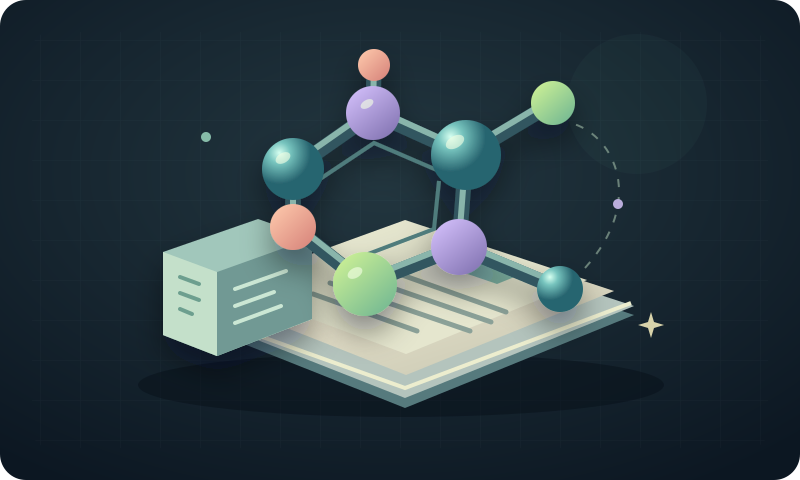</picture></a>
<sub><strong>NLP / RESEARCH VISUALIZATION</strong></sub>
<h3><a href="https://yashwant-rana.vercel.app/archive.html#bio-literature">Bioinformatics Literature &amp; Graph Explorer</a></h3>
<p>A related pair of research tools: an extremophile literature-mining pipeline and an interactive chemical–gene graph that makes prepared relationships and publication references easier to explore.</p>
<p><strong>Research capstone · two connected repositories</strong></p>
<p><code>Python</code> <code>pandas</code> <code>Entrez</code> <code>Streamlit</code> <code>NetworkX</code></p>
<a href="https://github.com/yashwant938/3DKnolwedgeGraph">Graph explorer ↗</a> · <a href="https://github.com/yashwant938/ExtremophilesData">Mining pipeline ↗</a>
</td>
<td width="50%" valign="top">
<a href="https://yashwant-rana.vercel.app/archive.html#android-classifier"><picture><source media="(prefers-reduced-motion: reduce)" srcset="./assets/projects/static/android-classifier.svg" /></picture></a>
<sub><strong>APPLIED ML / ANDROID</strong></sub>
<h3><a href="https://yashwant-rana.vercel.app/archive.html#android-classifier">Android Image Classifier</a></h3>
<p>An Android app that runs a bundled quantized MobileNet model locally to classify a selected gallery image and display its predicted label.</p>
<p><strong>Educational mobile prototype</strong></p>
<p><code>Kotlin</code> <code>Jetpack Compose</code> <code>TensorFlow Lite</code> <code>MobileNet</code></p>
<a href="https://github.com/yashwant938/ImageClassification">Android source ↗</a>
</td>
</tr>
<tr>
<td width="50%" valign="top">
<a href="https://yashwant-rana.vercel.app/archive.html#image-captioning"><picture><source media="(prefers-reduced-motion: reduce)" srcset="./assets/projects/static/image-captioning.svg" /></picture></a>
<sub><strong>COMPUTER VISION / LANGUAGE GENERATION</strong></sub>
<h3><a href="https://yashwant-rana.vercel.app/archive.html#image-captioning">Voice–Vision: Image Captioning</a></h3>
<p>A Flask image-captioning prototype combining InceptionV3 visual features with an LSTM language decoder to turn an uploaded image into a caption.</p>
<p><strong>Earlier ML prototype</strong></p>
<p><code>Python</code> <code>Flask</code> <code>TensorFlow / Keras</code> <code>InceptionV3</code> <code>LSTM</code></p>
<a href="https://github.com/yashwant938/Voice-Vision-Communication">Explore the prototype ↗</a>
</td>
<td width="50%" valign="top">
<a href="https://yashwant-rana.vercel.app/archive.html#decrypter-analyzer"><picture><source media="(prefers-reduced-motion: reduce)" srcset="./assets/projects/static/decrypter-analyzer.svg" /></picture></a>
<sub><strong>SECURITY EDUCATION / WEB TOOLS</strong></sub>
<h3><a href="https://yashwant-rana.vercel.app/archive.html#decrypter-analyzer">Decrypter &amp; Analyzer</a></h3>
<p>An educational PHP toolkit exploring hash demonstrations and basic website configuration inspection through browser-based forms and result panels.</p>
<p><strong>Educational prototype for authorized lab use</strong></p>
<p><code>PHP</code> <code>JavaScript</code> <code>MySQL</code> <code>HTML / CSS</code></p>
<a href="https://github.com/yashwant938/Decrypter-Analyzer">Source &amp; scope ↗</a>
</td>
</tr>
</table>

</details>

## Interactive sandbox &amp; live MCP

This profile repository doubles as a **live Systems × GenAI runtime**. Trigger either experiment below via a pre-filled GitHub Issue—GitHub Actions runs the isolated check in ~15 seconds, posts the full diff or Mermaid/SQL plan back on the issue, and automatically updates the **Latest Visitor Run** card:

<p align="center">
  <a href="https://github.com/yashwant938/yashwant938/issues?q=is%3Aissue+label%3Asandbox%3Aarchguard%2Csandbox%3Aclang">
    <picture>
      <source media="(max-width: 600px)" srcset="./assets/sandbox-latest-mobile.svg" />
      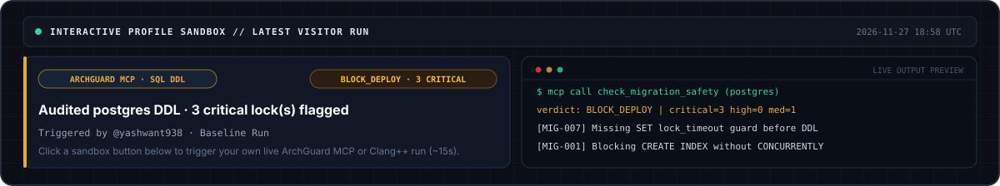
    </picture>
  </a>
</p>

<p align="center">
  <a href="https://github.com/yashwant938/yashwant938/issues/new?template=sandbox-archguard.yml">
    
  </a>
  <a href="https://github.com/yashwant938/yashwant938/issues/new?template=sandbox-clang.yml">
    
  </a>
</p>

<details>
<summary><strong>Or connect Claude / Cursor / Antigravity directly to my live ArchGuard MCP (5s, zero auth)</strong></summary>

```json
{
  "mcpServers": {
    "arch-guard": {
      "url": "https://arch-guard-mcp.yashwant938.workers.dev/mcp"
    }
  }
}
```

Official MCP Registry: [`io.github.yashwant938/arch-guard-mc@1.0.0`](https://registry.modelcontextprotocol.io/v0.1/servers/io.github.yashwant938%2Farch-guard-mc/versions/latest) · Explorer: [arch-guard-mcp.yashwant938.workers.dev ↗](https://arch-guard-mcp.yashwant938.workers.dev)

</details>

## Live upstream OSS &amp; edge telemetry

<p align="center">
  <a href="https://github.com/pulls?q=is%3Apr+author%3Ayashwant938+-user%3Ayashwant938">
    <picture>
      <source media="(max-width: 600px)" srcset="./assets/telemetry-panel-mobile.svg" />
      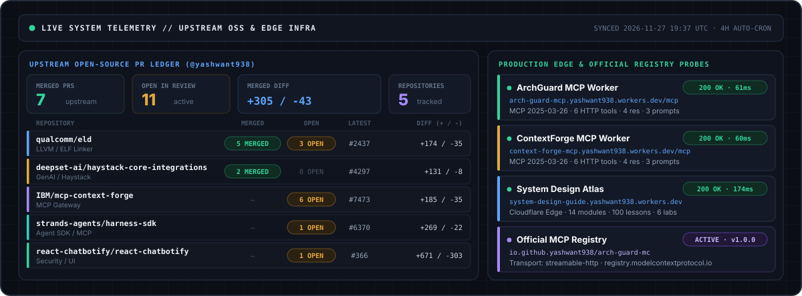
    </picture>
  </a>
</p>

## From issue to pull request

<p align="center">
  <a href="https://github.com/qualcomm/eld/pulls?q=is%3Apr+author%3Ayashwant938">
    <picture>
      <source media="(max-width: 600px)" srcset="./assets/contribution-flow-mobile.svg" />
      
    </picture>
  </a>
</p>

**Systems / LLVM:** [ELD #2134 — preserve AArch64 feature flags](https://github.com/qualcomm/eld/pull/2134) (one-line C++ fix, failing-before regression, **18 passing focused test runs** across two AArch64 configurations) alongside **5 merged fixes** in `qualcomm/eld` (`#2011`, `#2065`, `#2129`, `#2207`, `#2336`).

**GenAI / MCP tooling:** **2 merged fixes** in `deepset-ai/haystack-core-integrations` — [#4297](https://github.com/deepset-ai/haystack-core-integrations/pull/4297) (preserving empty tool-call arguments in `HuggingFaceAPIChatGenerator`) and [#4233](https://github.com/deepset-ai/haystack-core-integrations/pull/4233) (`NvidiaRanker` falsy metadata preservation, `191 passed` via `requests_mock`, lint & `mypy` clean) — plus active upstream MCP gateway and SDK PRs in [`IBM/mcp-context-forge`](https://github.com/IBM/mcp-context-forge/pulls?q=is%3Apr+author%3Ayashwant938) and [`strands-agents/harness-sdk`](https://github.com/strands-agents/harness-sdk/pull/6370).

<details>
<summary><strong>More open-source contributions and verification scope</strong></summary>

- **[ARM/AArch64 LTO fix · #2129](https://github.com/qualcomm/eld/pull/2129) · Merged** — Preserved native object generation with `--save-temps`. Full LTO, ThinLTO, and explicit assembly-output coverage; 16 focused tests passed, followed by the updated regression on all six target configurations.
- **[Linker-script warning locations · #2207](https://github.com/qualcomm/eld/pull/2207) · Merged** — Added exact source line numbers to duplicate `PROVIDE` / `PROVIDE_HIDDEN` warnings. Both regressions failed before the fix and passed afterward across six target configurations: 12 passes, no skips.
- **[YAML map assignments · #2336](https://github.com/qualcomm/eld/pull/2336) · Merged** — Included assignments before `SECTIONS` in YAML output, preserving assignment order and values. The new regression failed before the fix; all 18 focused tests passed across six target configurations.
- **[Haystack HuggingFace tool-call arguments · #4297](https://github.com/deepset-ai/haystack-core-integrations/pull/4297) · Merged** — Preserved empty tool-call arguments in `HuggingFaceAPIChatGenerator` with unit regression coverage.
- **[Haystack NVIDIA ranker metadata · #4233](https://github.com/deepset-ai/haystack-core-integrations/pull/4233) · Merged** — Changed `NvidiaRanker` metadata filtering from truthiness to `is not None` (matching `NvidiaDocumentEmbedder`) so falsy values pass through while `None` and missing fields remain skipped (`191 passed, 15 integration tests deselected`, HTTP mocked via `requests_mock`).
- **[Remapped linker scripts · #2437](https://github.com/qualcomm/eld/pull/2437) · Open** — Deferred remapped linker-script path validation to `Input::resolvePath()` so `--remap-inputs` and `-L` search paths apply before failing (`48 focused lit test cases` passed across six target configurations).
- **[IBM MCP Context Forge PRs](https://github.com/IBM/mcp-context-forge/pulls?q=is%3Apr+author%3Ayashwant938) &amp; [Strands Harness SDK #6370](https://github.com/strands-agents/harness-sdk/pull/6370) · Open** — MCP gateway federation, stdio-to-HTTP routing, prompt argument forwarding, and MCP tool-order preservation fixes.
- **[Build guidance · #2127](https://github.com/qualcomm/eld/pull/2127) · Open** — Document the LLVM `main` baseline and source/build path guidance following a [maintainer discussion](https://github.com/qualcomm/eld/discussions/887#discussioncomment-18761658).
- **[React ChatBotify · #366](https://github.com/react-chatbotify/react-chatbotify/pull/366) · Open** — Submitted chat-history HTML sanitization, URL checks, and an optional sanitizer callback with tests.

PR counts, statuses, and merged diff totals in the telemetry panel above refresh automatically every 4 hours directly from the GitHub API (`scripts/telemetry.py`). Test notes describe focused regressions recorded in each PR rather than full upstream integration suites.

</details>

<details>
<summary><strong>Algorithms and coding practice</strong></summary>

[DSA](https://github.com/yashwant938/DSA) · [CSES](https://github.com/yashwant938/CSES) · [LeetCode daily work](https://github.com/yashwant938/LeetcodeDailyCode) · [A-to-Z series](https://github.com/yashwant938/AtoZ100DaysSeries) · [Earlier LeetCode practice](https://github.com/yashwant938/DailyLeetcode) · [Striver A-to-Z](https://github.com/yashwant938/StriverAtozz)

</details>

## Toolbox

| Systems engineering | GenAI & applied ML | Backend & delivery |
| :--- | :--- | :--- |
| C / C++, Linux, GDB | RAG, BM25, MiniLM, RRF | Python, FastAPI, SQL |
| LLVM, CMake, Ninja, lit | MCP, LLM APIs, PyTorch, Hugging Face | TypeScript, React, Next.js, Docker |
| Filesystems, concurrency, static analysis | TensorFlow Lite, scikit-learn | Cloudflare Workers, PySide6, PHP, MySQL |

---

**Let's build at the intersection of systems and AI.** [Visit my portfolio ↗](https://yashwant-rana.vercel.app/) · [Connect on LinkedIn →](https://www.linkedin.com/in/yash-rana-3a7252265/)
