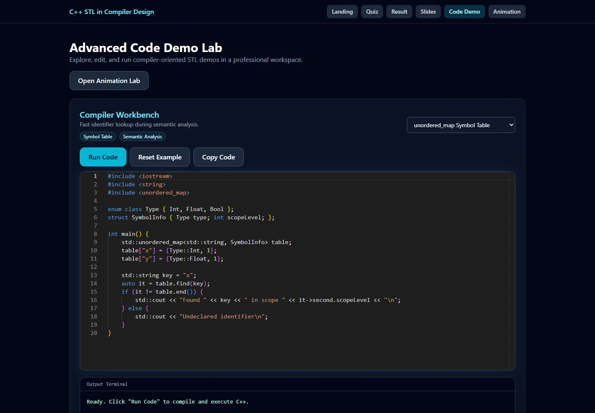
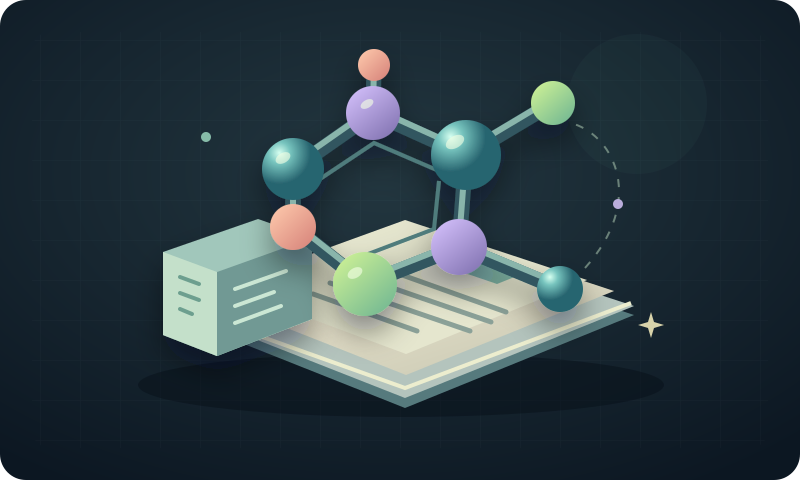

  <picture>
    <source media="(max-width: 600px)" srcset="./assets/header-mobile.svg" />
    
  </picture>

  <strong>Software engineer · Systems × GenAI · M.Tech, IIIT Delhi</strong>

  <a href="https://yashwant938.github.io/portfolio-/"><strong>Explore my portfolio &amp; project case studies ↗</strong></a> &nbsp; / &nbsp;
  <a href="#selected-work">Projects</a> &nbsp; / &nbsp;
  <a href="https://github.com/qualcomm/eld/pulls?q=is%3Apr+author%3Ayashwant938+is%3Amerged">Merged contributions</a> &nbsp; / &nbsp;
  <a href="https://www.linkedin.com/in/yash-rana-3a7252265/">LinkedIn</a>

I build across **systems engineering and generative AI**—from C++ linker fixes and Linux concurrency to retrieval-backed assistants and LLM-powered developer tools.

I care about what happens around the core algorithm: **reproducible failures, useful evidence, reliable APIs, and a product people can inspect and use.**

At **IBM India Software Labs**, I worked on the **IBM Z C/C++ compiler**, resolved **8+ production defects**, and implemented an **MCP service for compiler-diagnostic retrieval**. Software Engineer: July 2025–September 2026; intern: January–July 2025.

My [portfolio](https://yashwant938.github.io/portfolio-/#work) brings together **five featured projects**, linker contributions, implementation details, and code links. Search by technology or explore systems, AI/ML, applications, and research.

## Selected work

Five featured projects, in the same order as my [portfolio](https://yashwant938.github.io/portfolio-/#work).

<table>
<tr>
<td width="50%" valign="top">
<a href="https://yashwant938.github.io/portfolio-/#eld"><picture><source media="(prefers-reduced-motion: reduce)" srcset="./assets/projects/static/eld.svg" /></picture></a>
<strong>SYSTEMS · C++ · OPEN SOURCE</strong>
<h3><a href="https://github.com/qualcomm/eld">Qualcomm ELD Contributions</a></h3>

<strong>Two merged fixes</strong> in an ELF linker built on LLVM:

<ul>
<li><a href="https://github.com/qualcomm/eld/pull/2065"><strong>#2065</strong></a> — Fixed a PHDRS/FILEHDR layout crash.</li>
<li><a href="https://github.com/qualcomm/eld/pull/2011"><strong>#2011</strong></a> — Added GNU-compatible handling of numeric <code>-O</code> options.</li>
</ul>

Focused regression testing across six architecture configurations. Each PR records the verification scope.

<code>C++</code> <code>LLVM</code> <code>Linux</code> <code>lit / FileCheck</code>

<a href="https://github.com/qualcomm/eld/pulls?q=is%3Apr+author%3Ayashwant938">Explore the contributions →</a>
</td>
<td width="50%" valign="top">
<a href="https://yashwant938.github.io/portfolio-/#legal-lens"><picture><source media="(prefers-reduced-motion: reduce)" srcset="./assets/projects/static/legal-lens.svg" /></picture></a>
<strong>GENAI · RAG · INFORMATION RETRIEVAL</strong>
<h3><a href="https://github.com/ZainiiiBoyx278/legal-lens">Legal Lens 2.0</a></h3>

Contributed hybrid BM25 + MiniLM retrieval over a 1,871-page historical IPC PDF, with reciprocal rank fusion, page-linked evidence, and cited research briefs.

Local scope/intent classification and a RAG assistant with document-excerpt fallback.

<code>Python</code> <code>FastAPI</code> <code>Next.js</code> <code>MiniLM</code>

<a href="https://yashwant938.github.io/portfolio-/#legal-lens">Case study →</a> · <a href="https://github.com/ZainiiiBoyx278/legal-lens/pulls?q=is%3Apr+author%3Ayashwant938+is%3Amerged">My project PRs</a>
</td>
</tr>
<tr>
<td width="50%" valign="top">
<a href="https://yashwant938.github.io/portfolio-/#real-estate"><picture><source media="(prefers-reduced-motion: reduce)" srcset="./assets/projects/static/real-estate.svg" /></picture></a>
<strong>BACKEND / PROPERTY MARKETPLACE</strong>
<h3><a href="https://yashwant938.github.io/portfolio-/#real-estate">Real Estate Aggregator</a></h3>

A PHP/Slim property marketplace connecting searchable listings, account workflows, MySQL persistence, Razorpay integration, and generated PDF contracts.

<strong>Full-stack prototype</strong>

<code>PHP</code> <code>Slim</code> <code>MySQL</code> <code>JavaScript</code> <code>Razorpay</code> <code>TCPDF</code>

<a href="https://github.com/yashwant938/E-Commerce">Source &amp; architecture ↗</a>
</td>
<td width="50%" valign="top">
<a href="https://yashwant938.github.io/portfolio-/#gpt2-summarization"><picture><source media="(prefers-reduced-motion: reduce)" srcset="./assets/projects/static/gpt2-summarization.svg" /></picture></a>
<strong>NLP / COURSEWORK EXPERIMENT</strong>
<h3><a href="https://yashwant938.github.io/portfolio-/#gpt2-summarization">GPT-2 Review Summarization</a></h3>

A notebook experiment fine-tuning GPT-2 to turn Amazon Fine Food Reviews into short summaries, covering data preparation, training, checkpointing, and generation.

<strong>ML coursework · evaluation corrections documented</strong>

<code>Python</code> <code>PyTorch</code> <code>Hugging Face</code> <code>pandas</code> <code>Jupyter</code>

<a href="https://github.com/yashwant938/CSE508_Winter2024_A4_MT23107">Notebook &amp; findings ↗</a>
</td>
</tr>
<tr>
<td colspan="2" valign="top">

<strong>C++ / SYSTEMS / INTERACTIVE LEARNING</strong>
<h3><a href="https://yashwant938.github.io/portfolio-/#cpp-systems">C++ Concepts &amp; Systems Lab</a></h3>

Interactive C++ lessons and a C++17 filesystem lab exploring containers, recursive operations, and concurrency.

<ul><li>Step-through simulations, an editable compiler workspace, quizzes, and an optional Gemini tutor.</li><li>cd / ls / cp / mv / rm; sequential and threaded variants with synchronized output.</li></ul>

<code>C++17</code> <code>std::filesystem</code> <code>std::thread</code> <code>Linux</code> <code>React</code> <code>Monaco</code>

Two complementary labs: browser teaching simulations and an educational filesystem interpreter. Includes timing scripts; no measured speedup claimed.

<a href="https://yashwant938.github.io/CompilerCppTopics/">Live demo ↗</a> · <a href="https://github.com/yashwant938/CompilerCppTopics">Concepts source ↗</a> · <a href="https://github.com/yashwant938/OOPD-Project">Systems source ↗</a> · <a href="https://yashwant938.github.io/portfolio-/#cpp-systems">Case study →</a>
</td>
</tr>
</table>

<strong>Earlier projects &amp; explorations</strong>

More prototypes and learning projects, preserved in the <a href="https://yashwant938.github.io/portfolio-/archive.html#work">portfolio archive</a>. Illustrations below are concept artwork.

<table>
<tr>
<td width="50%" valign="top">
<a href="https://yashwant938.github.io/portfolio-/archive.html#llvm-bugsquad"><picture><source media="(prefers-reduced-motion: reduce)" srcset="./assets/projects/static/llvm-bugsquad.svg" /></picture></a>
<strong>GENAI × SYSTEMS · DEVELOPER TOOLS</strong>
<h3><a href="https://github.com/yashwant938/LLVMBugSquad">LLVM BugSquad</a></h3>

Compiler investigation workspace with model-assisted routing, isolated LLVM recipes, SQLite history, resumable events, and hashed evidence exports.

<strong>Status:</strong> synthetic replay demo. Live model/worker integration validation pending.

<code>Python</code> <code>FastAPI</code> <code>Docker</code> <code>LLM APIs</code>

<a href="https://yashwant938.github.io/portfolio-/archive.html#llvm-bugsquad">Case study →</a> · <a href="https://github.com/yashwant938/LLVMBugSquad#readme">Source &amp; setup</a>
</td>
<td width="50%" valign="top">
<a href="https://yashwant938.github.io/portfolio-/archive.html#newsscript"><picture><source media="(prefers-reduced-motion: reduce)" srcset="./assets/projects/static/newsscript.svg" /></picture></a>
<strong>GENAI · FULL-STACK APPLICATIONS</strong>
<h3><a href="https://github.com/yashwant938/NewsScript">NewsScript</a></h3>

RSS ingestion, deduplication, and heuristic ranking feed a script-drafting workspace with optional Gemini/OpenAI generation, saved articles, and text/PDF exports.

<strong>Status:</strong> local prototype with a template fallback. Live-provider validation and deployment hardening are pending.

<code>TypeScript</code> <code>Next.js</code> <code>Prisma</code> <code>LLM APIs</code>

<a href="https://yashwant938.github.io/portfolio-/archive.html#newsscript">Case study →</a> · <a href="https://github.com/yashwant938/NewsScript#readme">Source &amp; setup</a>
</td>
</tr>
<tr>
<td width="50%" valign="top">
<a href="https://yashwant938.github.io/portfolio-/archive.html#moodpet"><picture><source media="(prefers-reduced-motion: reduce)" srcset="./assets/projects/static/moodpet.svg" /></picture></a>
<strong>DESKTOP / PRODUCTIVITY</strong>
<h3><a href="https://yashwant938.github.io/portfolio-/archive.html#moodpet">MoodPet</a></h3>

A native Windows companion that combines an animated desktop pet with focus sessions, local activity history, persistent streaks, and a productivity dashboard.

<strong>Local Windows application</strong>

<code>Python</code> <code>PySide6</code> <code>SQLite</code> <code>Windows APIs</code>

<a href="https://github.com/yashwant938/MoodPet">Source &amp; setup ↗</a>
</td>
<td width="50%" valign="top">
<a href="https://yashwant938.github.io/portfolio-/archive.html#quizzes-by-iron"><picture><source media="(prefers-reduced-motion: reduce)" srcset="./assets/projects/static/quizzes-by-iron.svg" /></picture></a>
<strong>REAL-TIME / MULTIPLAYER</strong>
<h3><a href="https://yashwant938.github.io/portfolio-/archive.html#quizzes-by-iron">Quizzes by Iron</a></h3>

An event-driven multiplayer quiz with host-controlled rooms, QR-code joins, timed questions, server-side scoring, and live leaderboards.

<strong>Web application · room state held in one server process</strong>

<code>React</code> <code>Node.js</code> <code>Express</code> <code>Socket.IO</code> <code>Vite</code>

<a href="https://quizzesbyiron.vercel.app">Open app ↗</a> · <a href="https://github.com/yashwant938/quizzesbyiron">Source ↗</a>
</td>
</tr>
<tr>
<td width="50%" valign="top">
<a href="https://yashwant938.github.io/portfolio-/archive.html#bio-literature"><picture><source media="(prefers-reduced-motion: reduce)" srcset="./assets/projects/static/bio-literature.svg" /></picture></a>
<strong>NLP / RESEARCH VISUALIZATION</strong>
<h3><a href="https://yashwant938.github.io/portfolio-/archive.html#bio-literature">Bioinformatics Literature &amp; Graph Explorer</a></h3>

A related pair of research tools: an extremophile literature-mining pipeline and an interactive chemical–gene graph that makes prepared relationships and publication references easier to explore.

<strong>Research capstone · two connected repositories</strong>

<code>Python</code> <code>pandas</code> <code>Entrez</code> <code>Streamlit</code> <code>NetworkX</code>

<a href="https://github.com/yashwant938/3DKnolwedgeGraph">Graph explorer ↗</a> · <a href="https://github.com/yashwant938/ExtremophilesData">Mining pipeline ↗</a>
</td>
<td width="50%" valign="top">
<a href="https://yashwant938.github.io/portfolio-/archive.html#android-classifier"><picture><source media="(prefers-reduced-motion: reduce)" srcset="./assets/projects/static/android-classifier.svg" /></picture></a>
<strong>APPLIED ML / ANDROID</strong>
<h3><a href="https://yashwant938.github.io/portfolio-/archive.html#android-classifier">Android Image Classifier</a></h3>

An Android app that runs a bundled quantized MobileNet model locally to classify a selected gallery image and display its predicted label.

<strong>Educational mobile prototype</strong>

<code>Kotlin</code> <code>Jetpack Compose</code> <code>TensorFlow Lite</code> <code>MobileNet</code>

<a href="https://github.com/yashwant938/ImageClassification">Android source ↗</a>
</td>
</tr>
<tr>
<td width="50%" valign="top">
<a href="https://yashwant938.github.io/portfolio-/archive.html#image-captioning"><picture><source media="(prefers-reduced-motion: reduce)" srcset="./assets/projects/static/image-captioning.svg" /></picture></a>
<strong>COMPUTER VISION / LANGUAGE GENERATION</strong>
<h3><a href="https://yashwant938.github.io/portfolio-/archive.html#image-captioning">Voice–Vision: Image Captioning</a></h3>

A Flask image-captioning prototype combining InceptionV3 visual features with an LSTM language decoder to turn an uploaded image into a caption.

<strong>Earlier ML prototype</strong>

<code>Python</code> <code>Flask</code> <code>TensorFlow / Keras</code> <code>InceptionV3</code> <code>LSTM</code>

<a href="https://github.com/yashwant938/Voice-Vision-Communication">Explore the prototype ↗</a>
</td>
<td width="50%" valign="top">
<a href="https://yashwant938.github.io/portfolio-/archive.html#decrypter-analyzer"><picture><source media="(prefers-reduced-motion: reduce)" srcset="./assets/projects/static/decrypter-analyzer.svg" /></picture></a>
<strong>SECURITY EDUCATION / WEB TOOLS</strong>
<h3><a href="https://yashwant938.github.io/portfolio-/archive.html#decrypter-analyzer">Decrypter &amp; Analyzer</a></h3>

An educational PHP toolkit exploring hash demonstrations and basic website configuration inspection through browser-based forms and result panels.

<strong>Educational prototype for authorized lab use</strong>

<code>PHP</code> <code>JavaScript</code> <code>MySQL</code> <code>HTML / CSS</code>

<a href="https://github.com/yashwant938/Decrypter-Analyzer">Source &amp; scope ↗</a>
</td>
</tr>
</table>

## From issue to pull request

  <a href="https://github.com/qualcomm/eld/pulls?q=is%3Apr+author%3Ayashwant938">
    <picture>
      <source media="(max-width: 600px)" srcset="./assets/contribution-flow-mobile.svg" />
      
    </picture>
  </a>

**A recent example:** [ELD #2134 — preserve AArch64 feature flags](https://github.com/qualcomm/eld/pull/2134). A one-line C++ fix, a regression that failed before the change, and **18 passing focused test runs** across two AArch64 configurations. PR open for review.

**AI tooling:** [Hugging Face smolagents #2949](https://github.com/huggingface/smolagents/pull/2949) — **Draft** AST-validation fix for unpacking aliases in context managers, with tool export/reload regression coverage. The PR records **70 focused pytest passes**; scope acceptance and contributor review are pending.

<strong>More open-source contributions and verification scope</strong>

- **[ARM/AArch64 LTO fix · #2129](https://github.com/qualcomm/eld/pull/2129) · Open** — Preserve native object generation with `--save-temps`. Full LTO, ThinLTO, and explicit assembly-output coverage; 16 focused tests passed, followed by the updated regression on all six target configurations.
- **[Build guidance · #2127](https://github.com/qualcomm/eld/pull/2127) · Open** — Document the LLVM `main` baseline and source/build path guidance following a [maintainer discussion](https://github.com/qualcomm/eld/discussions/887#discussioncomment-18761658).
- **[React ChatBotify · #366](https://github.com/react-chatbotify/react-chatbotify/pull/366) · Open** — Submitted chat-history HTML sanitization, URL checks, and an optional sanitizer callback with tests.

Statuses checked **13 October 2026**. ELD #2011 and #2065 are merged; #2134, #2129, and #2127 remain open. smolagents #2949 is a draft; React ChatBotify #366 remains open. Results above describe focused tests recorded in the PRs, not full-suite runs or live integration validation of every project.

<strong>Algorithms and coding practice</strong>

[DSA](https://github.com/yashwant938/DSA) · [CSES](https://github.com/yashwant938/CSES) · [LeetCode daily work](https://github.com/yashwant938/LeetcodeDailyCode) · [A-to-Z series](https://github.com/yashwant938/AtoZ100DaysSeries) · [Earlier LeetCode practice](https://github.com/yashwant938/DailyLeetcode) · [Striver A-to-Z](https://github.com/yashwant938/StriverAtozz)

## Toolbox

| Systems engineering | GenAI & applied ML | Backend & delivery |
| :--- | :--- | :--- |
| C / C++, Linux, GDB | RAG, BM25, MiniLM, RRF | Python, FastAPI, SQL |
| LLVM, CMake, Ninja, lit | LLM APIs, PyTorch, Hugging Face | TypeScript, Next.js, Docker |
| Filesystems, concurrency | TensorFlow Lite, scikit-learn | PySide6, PHP, MySQL |

---

**Let's build at the intersection of systems and AI.** [Visit my portfolio ↗](https://yashwant938.github.io/portfolio-/) · [Connect on LinkedIn →](https://www.linkedin.com/in/yash-rana-3a7252265/)
