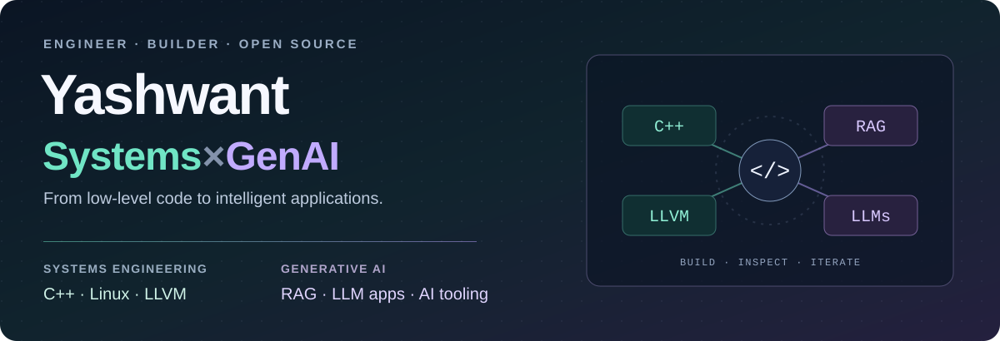

  <picture>
    <source media="(max-width: 600px)" srcset="./assets/header-mobile.svg" />
    
  </picture>

  <strong>Software engineer · Systems × GenAI · M.Tech, IIIT Delhi</strong>

  <a href="https://yashwant938.github.io/portfolio-/"><strong>Explore my portfolio &amp; project case studies ↗</strong></a> &nbsp; / &nbsp;
  <a href="#selected-work">Projects</a> &nbsp; / &nbsp;
  <a href="https://github.com/qualcomm/eld/pulls?q=is%3Apr+author%3Ayashwant938+is%3Amerged">Merged contributions</a> &nbsp; / &nbsp;
  <a href="https://www.linkedin.com/in/yash-rana-3a7252265/">LinkedIn</a>

I build across **systems engineering and generative AI**—from C++ linker fixes and Linux concurrency to retrieval-backed assistants and LLM-powered developer tools.

I care about what happens around the core algorithm: **reproducible failures, useful evidence, reliable APIs, and a product people can inspect and use.**

At **IBM India Software Labs**, I worked on the **IBM Z C/C++ compiler**, resolved **8+ production defects**, and implemented an **MCP service for compiler-diagnostic retrieval**. Software Engineer: July 2025–September 2026; intern: January–July 2025.

My [portfolio](https://yashwant938.github.io/portfolio-/#work) brings together **13 project case studies**, linker contributions, architecture explanations, and code links. Search by technology or explore systems, AI/ML, applications, and research.

## Selected work

<table>
<tr>
<td width="50%" valign="top">
<strong>GENAI · RAG · INFORMATION RETRIEVAL</strong>
<h3><a href="https://github.com/ZainiiiBoyx278/legal-lens">Legal Lens 2.0</a></h3>

Contributed hybrid BM25 + MiniLM retrieval over a 1,871-page historical IPC PDF, with reciprocal rank fusion, page-linked evidence, and cited research briefs.

Local scope/intent classification and a RAG assistant with document-excerpt fallback.

<code>Python</code> <code>FastAPI</code> <code>Next.js</code> <code>MiniLM</code>

<a href="https://yashwant938.github.io/portfolio-/#legal-lens">Case study →</a> · <a href="https://github.com/ZainiiiBoyx278/legal-lens/pulls?q=is%3Apr+author%3Ayashwant938+is%3Amerged">My project PRs</a>
</td>
<td width="50%" valign="top">
<strong>SYSTEMS · C++ · OPEN SOURCE</strong>
<h3><a href="https://github.com/qualcomm/eld">Qualcomm ELD contributions</a></h3>

<strong>Two merged fixes</strong> in an ELF linker built on LLVM:

<ul>
<li><a href="https://github.com/qualcomm/eld/pull/2065"><strong>#2065</strong></a> — Fixed a PHDRS/FILEHDR layout crash.</li>
<li><a href="https://github.com/qualcomm/eld/pull/2011"><strong>#2011</strong></a> — Added GNU-compatible handling of numeric <code>-O</code> options.</li>
</ul>

Focused regression testing across six architecture configurations. Each PR records the verification scope.

<code>C++</code> <code>LLVM</code> <code>Linux</code> <code>lit / FileCheck</code>

<a href="https://github.com/qualcomm/eld/pulls?q=is%3Apr+author%3Ayashwant938">Explore the contributions →</a>
</td>
</tr>
<tr>
<td width="50%" valign="top">
<strong>GENAI × SYSTEMS · DEVELOPER TOOLS</strong>
<h3><a href="https://github.com/yashwant938/LLVMBugSquad">LLVM BugSquad</a></h3>

Compiler investigation workspace with model-assisted routing, isolated LLVM recipes, SQLite history, resumable events, and hashed evidence exports.

<strong>Status:</strong> synthetic replay demo. Live model/worker integration validation pending.

<code>Python</code> <code>FastAPI</code> <code>Docker</code> <code>LLM APIs</code>

<a href="https://yashwant938.github.io/portfolio-/#llvm-bugsquad">Case study →</a> · <a href="https://github.com/yashwant938/LLVMBugSquad#readme">Source &amp; setup</a>
</td>
<td width="50%" valign="top">
<strong>GENAI · FULL-STACK APPLICATIONS</strong>
<h3><a href="https://github.com/yashwant938/NewsScript">NewsScript</a></h3>

RSS ingestion, deduplication, and heuristic ranking feed a script-drafting workspace with optional Gemini/OpenAI generation, saved articles, and text/PDF exports.

<strong>Status:</strong> local prototype with a template fallback. Live-provider validation and deployment hardening are pending.

<code>TypeScript</code> <code>Next.js</code> <code>Prisma</code> <code>LLM APIs</code>

<a href="https://yashwant938.github.io/portfolio-/#newsscript">Case study →</a> · <a href="https://github.com/yashwant938/NewsScript#readme">Source &amp; setup</a>
</td>
</tr>
</table>

## More projects

### Systems & AI foundations

- **[C++ Concepts Lab](https://github.com/yashwant938/CompilerCppTopics)** — Interactive container simulations, a Wandbox coding workspace, quizzes, and an optional Gemini tutor. **React · Monaco · C++** · [Open app](https://yashwant938.github.io/CompilerCppTopics/)
- **[C++ Filesystem & Concurrency Lab](https://github.com/yashwant938/OOPD-Project)** — Sequential and threaded filesystem commands, recursive traversal, and workload timing scripts. An educational Linux experiment. **C++17 · std::thread**
- **[GPT-2 Review Summarization](https://github.com/yashwant938/CSE508_Winter2024_A4_MT23107)** — Fine-tuning, checkpointing, and summary generation for review text. Coursework experiment; evaluation corrections are documented. **PyTorch · Hugging Face**

### Applications & desktop tools

- **[MoodPet](https://github.com/yashwant938/MoodPet)** — Windows desktop companion with focus timers, local activity history, charts, persistent streaks, and CSV export. **Python · PySide6 · SQLite**
- **[Quizzes by Iron](https://github.com/yashwant938/quizzesbyiron)** — Host/player rooms, QR joins, timed questions, server-side scoring, and live leaderboards. Room state is held in memory. **React · Express · Socket.IO** · [Open app](https://quizzesbyiron.vercel.app)
- **[Real Estate Aggregator](https://github.com/yashwant938/E-Commerce)** — Property marketplace prototype with listing filters, account workflows, Razorpay integration, and PDF contracts. **PHP · Slim · MySQL**
- **[Decrypter & Analyzer](https://github.com/yashwant938/Decrypter-Analyzer)** — Educational hash-lookup demonstrations and website-configuration inspection views for authorized lab use. **PHP · JavaScript · MySQL**

### Research & applied ML

- **Bioinformatics Literature & Graph Explorer** — PubMed literature processing, entity cleanup, rule-based interaction labels, and an interactive chemical–gene graph. One research family: [mining pipeline](https://github.com/yashwant938/ExtremophilesData) + [graph explorer](https://github.com/yashwant938/3DKnolwedgeGraph). **Python · Streamlit · NetworkX**
- **[Android Image Classifier](https://github.com/yashwant938/ImageClassification)** — Local inference on gallery images using a bundled quantized MobileNet model. Educational mobile prototype. **Kotlin · Compose · TensorFlow Lite**
- **[Voice–Vision: Image Captioning](https://github.com/yashwant938/Voice-Vision-Communication)** — Image uploads become captions through InceptionV3 features and an LSTM decoder. Earlier ML prototype. **Python · Flask · TensorFlow**

**[Explore implementation details and project scope in the portfolio →](https://yashwant938.github.io/portfolio-/#work)**

## From issue to pull request

  <a href="https://github.com/qualcomm/eld/pulls?q=is%3Apr+author%3Ayashwant938">
    <picture>
      <source media="(max-width: 600px)" srcset="./assets/contribution-flow-mobile.svg" />
      
    </picture>
  </a>

**A recent example:** [ELD #2134 — preserve AArch64 feature flags](https://github.com/qualcomm/eld/pull/2134). A one-line C++ fix, a regression that failed before the change, and **18 passing focused test runs** across two AArch64 configurations. PR open for review.

**AI tooling:** [Hugging Face smolagents #2949](https://github.com/huggingface/smolagents/pull/2949) — **Draft** AST-validation fix for unpacking aliases in context managers, with tool export/reload regression coverage. The PR records **70 focused pytest passes**; scope acceptance and contributor review are pending.

<strong>More open-source contributions and verification scope</strong>

- **[ARM/AArch64 LTO fix · #2129](https://github.com/qualcomm/eld/pull/2129) · Open** — Preserve native object generation with `--save-temps`. Full LTO, ThinLTO, and explicit assembly-output coverage; 16 focused tests passed, followed by the updated regression on all six target configurations.
- **[Build guidance · #2127](https://github.com/qualcomm/eld/pull/2127) · Open** — Document the LLVM `main` baseline and source/build path guidance following a [maintainer discussion](https://github.com/qualcomm/eld/discussions/887#discussioncomment-18761658).
- **[React ChatBotify · #366](https://github.com/react-chatbotify/react-chatbotify/pull/366) · Open** — Submitted chat-history HTML sanitization, URL checks, and an optional sanitizer callback with tests.

Statuses checked **13 October 2026**. ELD #2011 and #2065 are merged; #2134, #2129, and #2127 remain open. smolagents #2949 is a draft; React ChatBotify #366 remains open. Results above describe focused tests recorded in the PRs, not full-suite runs or live integration validation of every project.

<strong>Algorithms and coding practice</strong>

[DSA](https://github.com/yashwant938/DSA) · [CSES](https://github.com/yashwant938/CSES) · [LeetCode daily work](https://github.com/yashwant938/LeetcodeDailyCode) · [A-to-Z series](https://github.com/yashwant938/AtoZ100DaysSeries) · [Earlier LeetCode practice](https://github.com/yashwant938/DailyLeetcode) · [Striver A-to-Z](https://github.com/yashwant938/StriverAtozz)

## Toolbox

| Systems engineering | GenAI & applied ML | Backend & delivery |
| :--- | :--- | :--- |
| C / C++, Linux, GDB | RAG, BM25, MiniLM, RRF | Python, FastAPI, SQL |
| LLVM, CMake, Ninja, lit | LLM APIs, PyTorch, Hugging Face | TypeScript, Next.js, Docker |
| Filesystems, concurrency | TensorFlow Lite, scikit-learn | PySide6, PHP, MySQL |

---

**Let's build at the intersection of systems and AI.** [Visit my portfolio ↗](https://yashwant938.github.io/portfolio-/) · [Connect on LinkedIn →](https://www.linkedin.com/in/yash-rana-3a7252265/)
